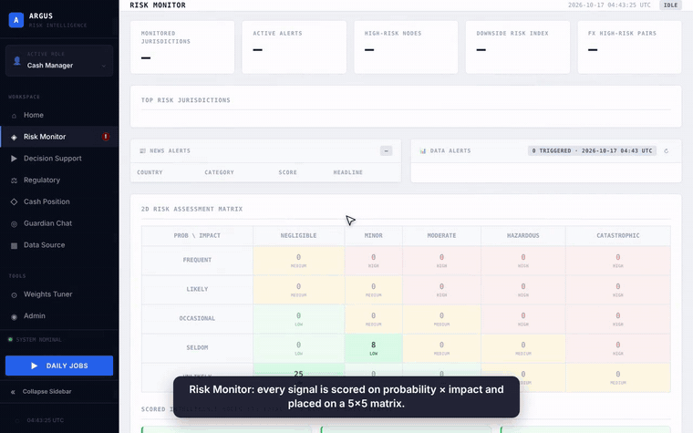
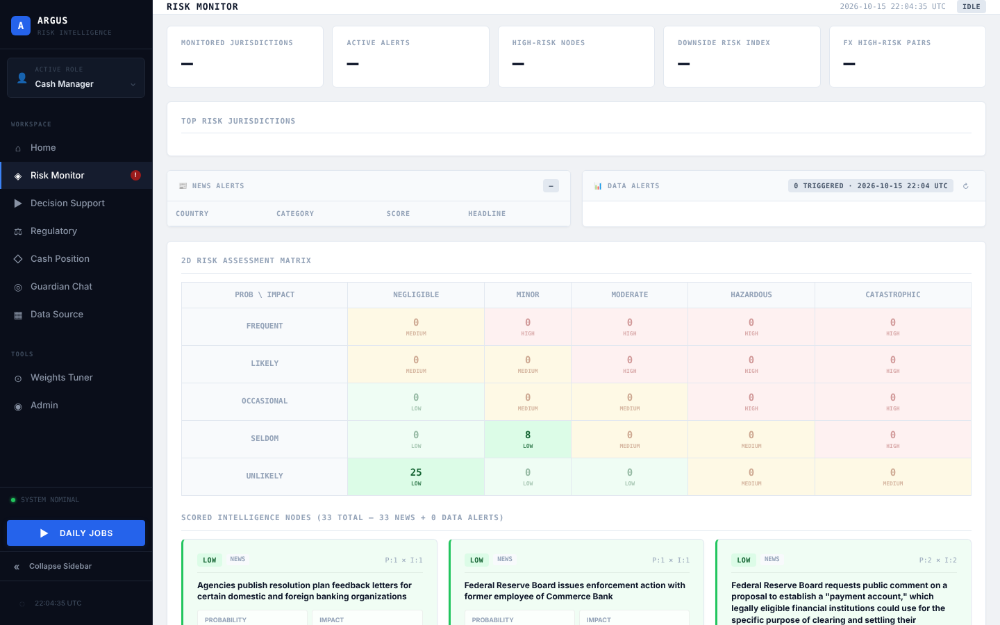
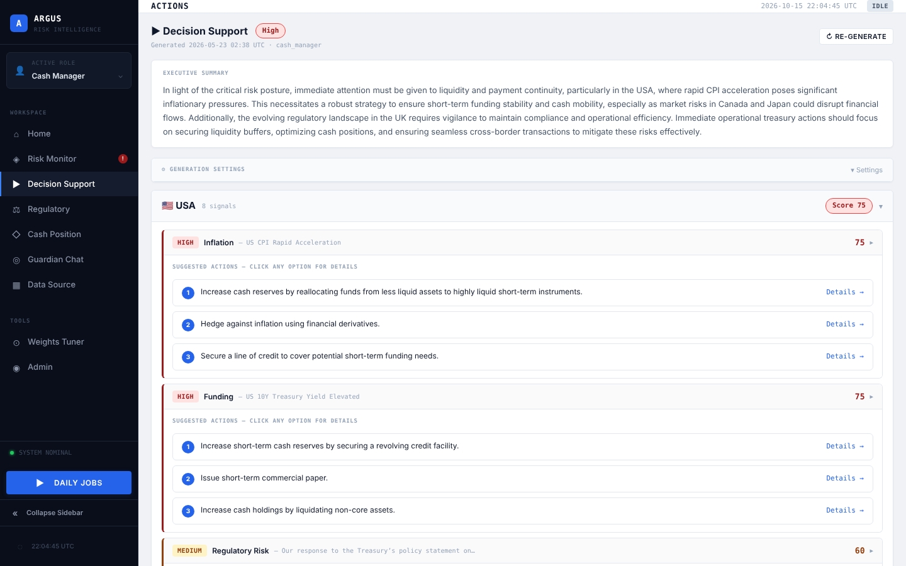
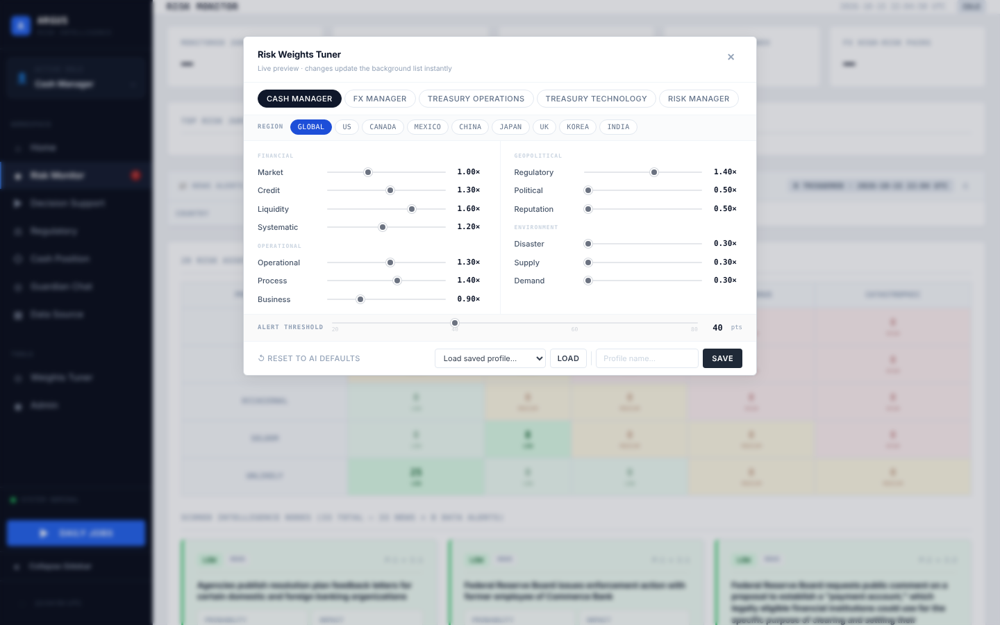

# Argus — Persona-Driven Risk Intelligence for Corporate Treasury

> **Portfolio copy.** Argus was built by a student team at Santa Clara University for a corporate treasury team. All cash, entity and position figures in this repository are **simulated**. This is not an official product of any company. Shared for portfolio review only — see [License](#license).

**Argus turns hundreds of daily market, policy and world events into a short, role-specific list of treasury risks — each scored on a Probability × Impact matrix and paired with concrete next actions.**

Python · Flask · GPT-4o · Claude · RAG (ChromaDB) · scikit-learn · Google Cloud Storage · 37+ public data sources

<p align="center">
  <a href="docs/demo.mp4"></a><br>
  <sub>Walkthrough: risk matrix → decision support with SWOT per action → cash position → role-weighted risk tuner (simulated data). ▶ <a href="docs/demo.mp4">Full video with captions (MP4, 80 s)</a></sub>
</p>

<p align="center">
  <br>
  <sub>Risk Monitor — every event placed on a 5×5 Probability × Impact matrix</sub>
</p>

---

## The problem

A treasury team is responsible for liquidity, funding, FX exposure and cash across many countries. The data they need is public and abundant — central-bank decisions, yields, FX moves, inflation prints, regulatory changes, sanctions, even earthquakes near a supplier hub. **The hard part is triage:** for each signal, *how likely is it to matter, how badly would it hurt us, and does it matter to me given my role and region?*

Conventional dashboards report **data**. They don't report **risk**, and they show every user the same thing. A cash manager in Mexico and an FX manager in Japan reading the same headline care about completely different things.

## The product

| Surface | What it gives the user |
|---|---|
| **Risk Monitor** | A prioritized list of current risks, each as a colored cell on a 5×5 Probability × Impact matrix |
| **Intelligence Brief** | A short AI-written summary of what matters *for my role* today, citing the underlying news (RAG) |
| **Decision Support** | For each significant risk, 2–3 concrete actions with a why-now rationale |
| **Persona Weights Tuner** | Each user adjusts how much they care about 13 risk categories, per region, and sees the list re-rank live |
| **Guardian Chat** | Ask "what happened in China this month?" and get an answer grounded in the system's own records |
| **Cash Position** | Multi-currency cash by entity and region, so risk can be read against exposure |

<p align="center">
  
  <br>
  <sub>Left: action cards per risk. Right: persona tuner — same events, different priorities per role.</sub>
</p>

## Key product decisions

**1. The LLM proposes, the matrix decides.** In a risk function, an AI that "just answers" is not trustworthy. The core of Argus is a classical, inspectable risk model (5×5 Probability × Impact). Scores come from three layers — deterministic keyword/threshold rules, LLM judgment, and a supervised ML model — and the matrix resolves the final level. No single LLM call can set a risk level on its own, and every score can be traced back.

**2. Personalization is the product, not a prompt tweak.** The same event is *High* for one role and *Low* for another, by design. Each persona (cash manager, FX manager, treasury operations, treasury technology, risk manager) is a set of weights over 13 risk categories, with region overrides (e.g. a cash manager weights political risk higher for Mexico, regulatory risk higher for China) and its own alert threshold. AI generates the baseline; users can tune and save their own profiles; the baseline is never silently overwritten.

**3. Every alert must lead to a next step.** A notification the user can't act on is noise. Action cards turn a signal into a candidate decision, and retrieve similar past recommendations so similar situations get consistent advice.

**4. Bounded, metered AI.** Agents have hard caps on turns, tokens and dollars per call; all LLM calls go through one router that can fail over between providers; every call, retrieval and agent run is logged so the team can answer *what did this user action cost?*

## How we evaluated the AI

Personalization only matters if personas actually see different things — so we measured it.

- A **persona evaluation harness** compares each persona's top-20 alerts (Jaccard similarity between personas) and uses an **LLM-as-judge** to check whether each list fits that role's job-to-be-done, producing suggested weight changes for human review (never auto-applied).
- **What it caught:** after a noise-filter change, the harness showed a **Jaccard of 1.00** — all four personas were getting the *identical* top-20, so personalization wasn't working at all. Digging in, 85% of alerts came from a single low-signal source (ECB reference rates), and the real root cause was upstream: live data was arriving but wasn't being classified (every alert was "Unclassified", score 0). The fix moved scoring into Argus's own loader instead of patching personas.
- **Takeaway:** the metric that mattered wasn't model accuracy, it was *does the product differ by user* — and checking it surfaced a data-pipeline bug that no unit test would have found.

Details: [`docs/PERSONA_EVAL.md`](docs/PERSONA_EVAL.md), [`docs/PERSONA_EVAL_REBASELINE_2026-05-19.md`](docs/PERSONA_EVAL_REBASELINE_2026-05-19.md), full write-up in [`docs/REPORT_ARGUS.md`](docs/REPORT_ARGUS.md).

## Architecture

```
 37+ public sources (FRED, Fed, GDELT, USGS, NOAA, SEC, central-bank RSS …)
                │  upstream collector writes daily CSV partitions
                ▼
      Google Cloud Storage ──► Guardian loader ──► classification (13 risk categories)
                                                         │
                         ┌───────────────────────────────┼───────────────────────────┐
                         ▼                               ▼                           ▼
                rules / thresholds              LLM scoring (Claude)        ML downside model
                         └──────────────► 5×5 Probability × Impact matrix ◄─────────┘
                                                         │
                                          persona weights + region overrides
                                                         │
          Risk Monitor · Intelligence Brief (RAG) · Action cards · Guardian Chat · Cash view
```

## My role

Team of four — **Ariel Ng** (built the majority of the platform), **Jason Geng**, **@unafelicia**, **Tanish J**. The full commit history is preserved so individual contributions are visible.

What I (**Jason Geng**) owned:

- **Live data dashboard and multilingual risk board** — the first integration of Google Cloud Storage live snapshots into the dashboard, so the product showed real daily data instead of static samples.
- **Persona dashboard and the cash-manager decision flow** — an early version of role-specific views: what a cash manager sees, in what order, and which decisions it should prompt.
- **Downside-risk model demo** — the model-training demo for the downside-risk ML model that feeds the Probability axis, plus the weights-tuning modal and risk-category UI used to tune the risk monitor.
- **Downside risk index** — scoring the index from the latest GCS risk signals, with a fallback to the most recent available partition so the index never goes blank.
- Reliability fixes for GCS authentication and dashboard copy for global monitoring.

## Run it locally

```bash
git clone https://github.com/jasonmayg/argus.git && cd argus
python3 -m venv .venv && source .venv/bin/activate
pip install -r requirements.txt
cp .env.example .env          # add OPENAI_API_KEY / ANTHROPIC_API_KEY for AI features
python frontend_app.py        # http://localhost:5050
```

Without API keys or cloud credentials the UI runs on the bundled sample snapshot; AI-generated briefs and live data need keys. Full setup, API reference and deployment notes: [`docs/DEVELOPER_GUIDE.md`](docs/DEVELOPER_GUIDE.md).

## License

© 2026 Ariel Ng, Jason Geng, and the Argus team. **All rights reserved.** This repository is published for viewing as part of a portfolio. No permission is granted to copy, modify, redistribute, or use the code or documentation without written consent from the authors.
